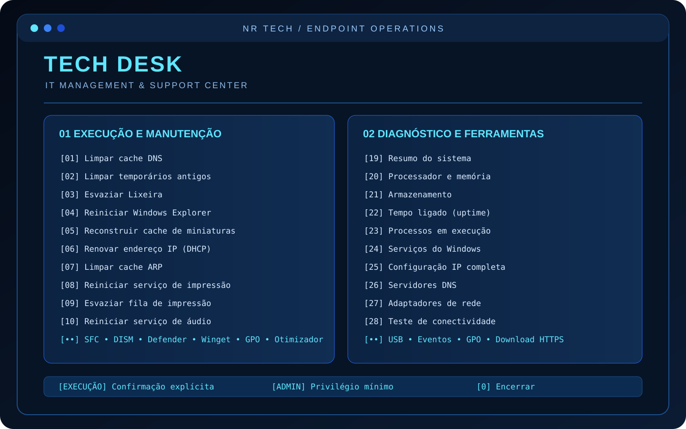
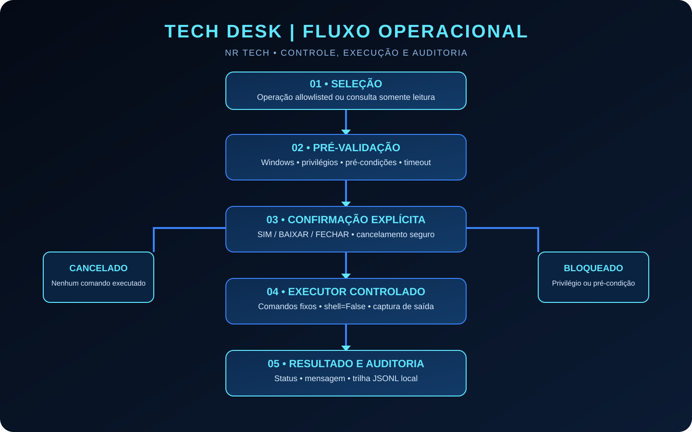

# TECH DESK

### NR TECH | IT MANAGEMENT & SUPPORT CENTER

Central inteligente de suporte, diagnóstico e manutenção de endpoints Windows.

[Instalar pelo PyPI](https://pypi.org/project/tech-desk/) · [Última versão](https://github.com/nrdataanalysis-1908/TECH-DESK/releases/latest) · [Código-fonte](https://github.com/nrdataanalysis-1908/TECH-DESK)

  

## Visão geral

O TECH DESK reúne rotinas de suporte técnico em uma CLI modular, com catálogo fechado de operações, confirmações explícitas, verificação de privilégios, timeout, captura de resultados e trilha de auditoria.

## Instalação rápida

O TECH DESK está publicado no Python Package Index (PyPI). Em um computador Windows com Python 3.11 ou superior, abra o PowerShell ou Prompt de Comando e execute:

~~~powershell
py -m pip install --upgrade tech-desk
~~~

Depois, inicie a ferramenta com:

~~~powershell
techdesk
~~~

Pronto: o menu principal será exibido no terminal. Não é necessário clonar o repositório para utilizar a versão publicada.

Se o comando `techdesk` não for reconhecido após a instalação, feche e abra novamente o terminal. Caso persista, adicione ao PATH do usuário o diretório Scripts da instalação Python.

- Projeto no PyPI: https://pypi.org/project/tech-desk/
- Histórico de versões e arquivos: https://github.com/nrdataanalysis-1908/TECH-DESK/releases
- Instalação de uma versão específica: `py -m pip install tech-desk==0.1.0`

## Recursos incorporados

### Operações de manutenção

| Área | Recursos |
|---|---|
| Sistema | Limpeza completa dos arquivos da TEMP do usuário, SFC, DISM e CHKDSK online |
| Rede | Limpeza DNS/ARP, renovação DHCP, redefinição Winsock e conectividade |
| Impressão e periféricos | Reinício do Spooler, limpeza da fila e inventário USB |
| Segurança | Microsoft Defender, atualização de assinaturas, verificação rápida e Firewall |
| Windows | Reinício de Explorer/áudio/Windows Update, ponto de restauração e atualização GPO |
| Logs | Backup EVTX de Application, System, Setup e Security; limpeza de Application/Setup somente após backup |
| Aplicativos | Consulta de atualizações e atualização geral via Winget, mediante confirmação |
| Memória | Inventário dos processos de maior consumo e solicitação de fechamento gracioso por PID |

### Ferramentas e consultas

- Informações avançadas do sistema (msinfo32).
- Gerenciador de Dispositivos e Limpeza de Disco.
- PowerShell aberto como ferramenta local, sem execução de comandos arbitrários pelo TECH DESK.
- Teste de velocidade no navegador padrão.
- Diagnóstico de CPU, memória, armazenamento, uptime, processos e serviços.
- Inventário de software, USB, eventos e políticas de grupo.
- Submenu de otimização de memória com ações individuais e sequência guiada, sempre com confirmação.
- Download HTTPS limitado a 100 MiB, com redirecionamentos exclusivamente HTTPS e cálculo SHA-256. O arquivo é salvo, nunca executado pelo TECH DESK.

## Fluxo operacional

  

1. O técnico seleciona uma operação do catálogo ou uma consulta somente leitura.
2. O TECH DESK apresenta escopo, risco e exigência de privilégio.
3. Operações de alteração exigem confirmação textual explícita.
4. O núcleo valida ambiente, privilégios e pré-condições.
5. O executor chama somente comandos previamente definidos, sem shell intermediário e com timeout.
6. O resultado é apresentado e os metadados da execução são gravados na auditoria local.

## Controles de segurança

- Allowlist: não há execução de comandos arbitrários fornecidos pelo usuário.
- Confirmação explícita antes de qualquer alteração.
- Privilégio mínimo e bloqueio quando a elevação é necessária.
- subprocess com shell=False, timeout e captura do código de saída.
- Limpeza de temporários remove arquivos regulares da TEMP do usuário sem limite de idade; preserva diretórios e links simbólicos e ignora arquivos bloqueados ou sem permissão.
- Limpeza de eventos exporta Application e Setup antes da exclusão; o log Security é preservado.
- Fechamento de processos solicita encerramento gracioso; não utiliza encerramento forçado.
- Download HTTPS sem execução automática, com limite de tamanho, validação de redirecionamento e SHA-256.
- Auditoria JSONL local sem registrar a saída potencialmente sensível dos comandos.

## Instalação para desenvolvimento

Para contribuir com o código-fonte, clone o repositório e instale as dependências de desenvolvimento:

~~~powershell
git clone https://github.com/nrdataanalysis-1908/TECH-DESK.git
cd TECH-DESK
py -3.11 -m venv .venv
.\.venv\Scripts\Activate.ps1
python -m pip install --upgrade pip
pip install -e ".[dev]"
~~~

## Execução e diagnóstico

Após a instalação para desenvolvimento, execute:

~~~powershell
python -m techdesk.cli
python -m techdesk.cli --diagnostics
python -m techdesk.cli --diagnostic usb
python -m techdesk.cli --diagnostic gpresult
python -m techdesk.cli --diagnostic performance
~~~

Abra o terminal como Administrador somente quando uma operação exigir elevação. O TECH DESK não tenta elevar privilégios silenciosamente.

## Qualidade

~~~powershell
pytest
ruff check .
~~~

O GitHub Actions executa testes e lint em Windows e Linux. CI verde não substitui validação funcional de cada rotina em uma máquina Windows real.

## Arquitetura atual

- Core Python: catálogo, políticas, validações, execução e auditoria.
- Adaptadores Windows: comandos nativos e PowerShell com argumentos fixos.
- Interface atual: CLI.
- Persistência: auditoria local JSONL.
- Desktop Tauri, API web, agente local autenticado e PostgreSQL centralizado: evolução planejada, ainda não implementada.

## Distribuição e publicação

- Distribuição Python oficial: [PyPI — tech-desk](https://pypi.org/project/tech-desk/).
- Código-fonte, issues e contribuições: [GitHub — TECH-DESK](https://github.com/nrdataanalysis-1908/TECH-DESK).
- Versões e artefatos de lançamento: [GitHub Releases](https://github.com/nrdataanalysis-1908/TECH-DESK/releases).

O GitHub Packages não é utilizado para esta distribuição: o registro nativo de pacotes Python é o PyPI. As versões publicadas no PyPI são imutáveis; novas correções e funcionalidades devem ser lançadas com um novo número de versão.

## Estado de validação

As rotinas possuem testes automatizados de catálogo, dispatch, cancelamento, privilégios e guardrails. A execução funcional em Windows real deve ser validada individualmente, especialmente operações que alteram serviços, logs, rede, aplicativos e arquivos.

## Licença

MIT. Consulte LICENSE.

### Downloads de suporte

O download de arquivos aceita somente HTTPS na porta padrão, valida redirecionamentos, verifica Content-Length quando fornecido, limita o arquivo a 100 MiB e calcula SHA-256. O TECH DESK apenas salva o conteúdo; não executa arquivos baixados.
