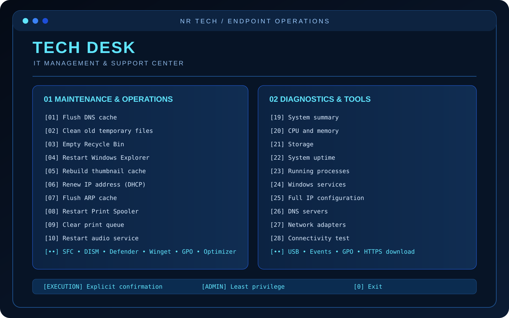

# TECH DESK

### NR TECH | IT MANAGEMENT & SUPPORT CENTER

An intelligent support, diagnostics, and maintenance toolkit for Windows endpoints.

[Install from PyPI](https://pypi.org/project/tech-desk/) · [Latest release](https://github.com/nrdataanalysis-1908/TECH-DESK/releases/latest) · [Source code](https://github.com/nrdataanalysis-1908/TECH-DESK)

## Overview

TECH DESK brings IT support routines together in a modular CLI, with a closed operation catalog, explicit confirmations, privilege checks, timeouts, result capture, and an audit trail.

## Quick installation

TECH DESK is published on the Python Package Index (PyPI). On a Windows computer with Python 3.11 or newer, open PowerShell or Command Prompt and run:

~~~powershell
py -m pip install --upgrade tech-desk
~~~

Then start the tool with:

~~~powershell
techdesk
~~~

The main menu will appear in the terminal. Cloning the repository is not required to use the published version.

If the `techdesk` command is not recognized after installation, close and reopen the terminal. If the issue persists, add the Python installation's Scripts directory to the user's PATH.

- PyPI project: https://pypi.org/project/tech-desk/
- Release history and files: https://github.com/nrdataanalysis-1908/TECH-DESK/releases
- Install a specific version: `py -m pip install tech-desk==0.1.0`

## Built-in capabilities

### Maintenance operations

| Area | Capabilities |
|---|---|
| System | Full cleanup of eligible files in the user's TEMP directory, scheduled maintenance, SFC, DISM, and online CHKDSK |
| Network | DNS/ARP cleanup, DHCP renewal, Winsock reset, and connectivity checks |
| Printing and peripherals | Spooler restart, queue cleanup, and USB inventory |
| Security | Microsoft Defender, signature updates, quick scan, and Firewall |
| Windows | Explorer/audio/Windows Update restart, restore point, and GPO refresh |
| Logs | EVTX backup for Application, System, Setup, and Security; Application/Setup cleanup only after backup |
| Applications | Update discovery and general updates through Winget, subject to confirmation |
| Memory | Inventory of highest-memory processes and graceful close requests by PID |

### Tools and diagnostics

- Advanced system information (msinfo32).
- Device Manager and Disk Cleanup.
- PowerShell opened as a local tool, without arbitrary command execution by TECH DESK.
- Speed test in the default browser.
- CPU, memory, storage, uptime, process, and service diagnostics.
- Software, USB, event, and Group Policy inventory.
- Memory optimization submenu with individual actions and a guided sequence, always requiring confirmation.
- HTTPS downloads limited to 100 MiB, with HTTPS-only redirects and SHA-256 calculation. The file is saved, never executed by TECH DESK.

## Operational workflow

  

1. The technician selects an operation from the catalog or a read-only diagnostic.
2. TECH DESK displays scope, risk, and privilege requirements.
3. Mutating operations require explicit textual confirmation.
4. The core validates the environment, privileges, and preconditions.
5. The executor invokes only predefined commands, without an intermediate shell and with a timeout.
6. The result is displayed and execution metadata is written to the local audit log.

## Security controls

- Allowlist: arbitrary user-supplied commands are not executed.
- Explicit confirmation before any change.
- Least privilege and blocking when elevation is required.
- subprocess with `shell=False`, timeout, and exit-code capture.
- TEMP cleanup removes regular files regardless of age; preserves directories and links/reparse points and skips locked or inaccessible files.
- Event cleanup exports Application and Setup before deletion; the Security log is preserved.
- Process closing requests graceful termination; forced termination is not used.
- HTTPS downloads do not execute automatically and enforce size limits, redirect validation, and SHA-256.
- Local JSONL auditing without recording potentially sensitive command output.

## Development installation

To contribute to the source code, clone the repository and install the development dependencies:

~~~powershell
git clone https://github.com/nrdataanalysis-1908/TECH-DESK.git
cd TECH-DESK
py -3.11 -m venv .venv
.\.venv\Scripts\Activate.ps1
python -m pip install --upgrade pip
pip install -e ".[dev]"
~~~

## Execution and diagnostics

After installing the development version, run:

~~~powershell
python -m techdesk.cli
python -m techdesk.cli --diagnostics
python -m techdesk.cli --diagnostic usb
python -m techdesk.cli --diagnostic gpresult
python -m techdesk.cli --diagnostic performance
~~~

### Automated maintenance outside the menu

TECH DESK also provides command-line maintenance and the `TECH-DESK-Maintenance.bat` shortcut, without opening the main menu. The module cleans the user's TEMP directory, attempts to empty the Recycle Bin through the native Windows cmdlet, and records results under `%LOCALAPPDATA%\\NRTech\\TechDesk\\logs`.

~~~powershell
python -m techdesk.maintenance
python -m techdesk.maintenance --run
python -m techdesk.maintenance --install-schedule
python -m techdesk.maintenance --status
~~~

The scheduler registers or updates daily tasks at 08:00 and 18:00 for the current user, without administrative elevation. The Recycle Bin is handled as an independent step: a native failure is recorded as a warning, and no files inside `$Recycle.Bin` are manually removed.

Run the terminal as Administrator only when an operation requires elevation. TECH DESK never attempts to elevate privileges silently.

## Quality

~~~
pytest
ruff check .
~~~

GitHub Actions runs tests and linting on Windows and Linux. A green CI run does not replace functional validation of each routine on a real Windows machine.

## Current architecture

- Python core: catalog, policies, validation, execution, and auditing.
- Windows adapters: native commands and PowerShell with fixed arguments.
- Current interface: CLI.
- Persistence: local JSONL audit log.
- Tauri desktop app, web API, authenticated local agent, and centralized PostgreSQL: planned evolution, not yet implemented.

## Distribution and publishing

- Official Python distribution: [PyPI — tech-desk](https://pypi.org/project/tech-desk/).
- Source code, issues, and contributions: [GitHub — TECH-DESK](https://github.com/nrdataanalysis-1908/TECH-DESK).
- Releases and release artifacts: [GitHub Releases](https://github.com/nrdataanalysis-1908/TECH-DESK/releases).

GitHub Packages is not used for this distribution: the native Python package registry is PyPI. Published PyPI versions are immutable; new fixes and features must be released under a new version number.

## Validation status

The routines have automated tests for catalog behavior, dispatch, cancellation, privileges, and guardrails. Functional execution on real Windows systems must be validated individually, especially for operations that change services, logs, network settings, applications, and files.

## License

MIT. See LICENSE.

### Support downloads

File downloads accept HTTPS only on the default port, validate redirects, check Content-Length when provided, enforce a 100 MiB limit, and calculate SHA-256. TECH DESK only saves the content; it does not execute downloaded files.
